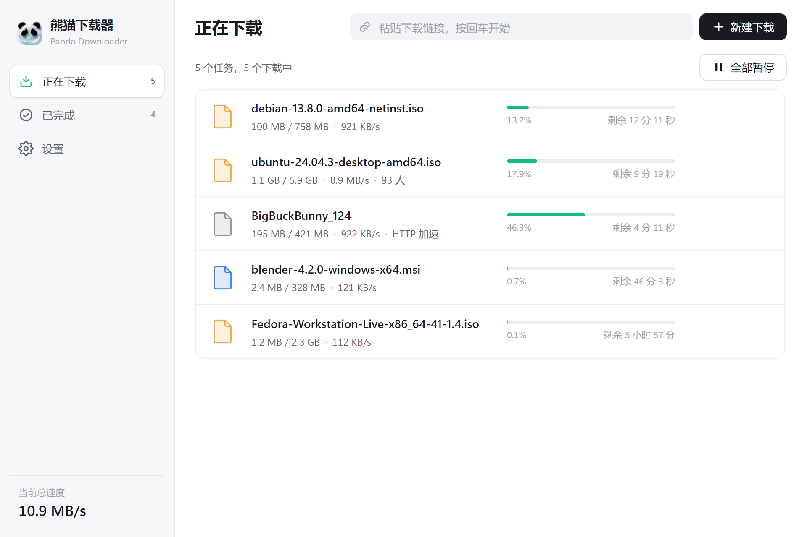

<div align="center">


# 熊猫下载器 Panda Downloader

**一个工具搞定 HTTP 多线程、BT / 磁力、视频网站和迅雷链接的全场景下载器：开源、无广告、断点续传。**

[](../../releases)
[](../../releases)
[](LICENSE)
[](https://tauri.app)

[下载安装包](../../releases) · [功能](#-核心特性) · [快速开始](#-快速开始) · [参数配置](#-参数配置) · [路线图](#-路线图)

</div>

---

## 🖼️ 界面预览

<div align="center">
  
</div>

## ✨ 核心特性

- 🚀 **IDM 级多线程**：多连接分段，先下完的连接会接手最慢连接的后半段，不会"卡在 99%"
- 🔁 **断点续传不白下**：崩溃、断电、强杀进程、链接过期、换新链接都能接着下；服务器文件变了会自动作废旧数据，不会拼出坏文件
- 🧲 **BT / 磁力全速下载**：复制磁力链接、双击 `.torrent` 都能下；自动追加公共 Tracker、每个种子最多 250 个连接、监听端口 + UPnP
- 🌐 **网络种子加速**：种子附带 HTTP 地址时，BT 慢就自动用多线程 HTTP 一起下，下完逐块校验哈希（实测 0.19 MB/s → 1.9 MB/s）
- 🎬 **视频网站一键下载**：B 站、YouTube 等上千个网站，选清晰度后自动合并音视频；抖音、快手、小红书、微博、X、Instagram 等在浏览器里点「熊猫下载」
- 🔗 **迅雷 / 快车 / 旋风链接**：`thunder://`、`flashget://`、`qqdl://` 自动解包，支持多层嵌套和 GBK 老链接
- 🧩 **浏览器扩展**：接管 Chrome / Edge 下载（自动带上 Cookie 和来源页）、嗅探网页视频、右键菜单
- 📋 **复制即下载**：复制链接自动弹出确认窗，弹出时已经在后台开始下载，按回车即可
- 🪟 **不打扰**：右上角小窗口始终置顶，只显示总速度，点开才看每个任务；全屏玩游戏、看视频时不弹任何窗口；下载完成主按钮自动变成解压 / 播放 / 扫描并运行
- 🔒 **开源无广告**：GPL-3.0 协议，不收集数据，不捆绑软件

> [!NOTE]
> 不支持有 DRM 版权加密的视频（Netflix、各平台付费会员内容等），也不支持 PT 私有种子。

## 🚀 快速开始

### 普通用户

1. 到 [Releases](../../releases) 下载最新的 `PandaDownloader_x.y.z_Setup.exe`
2. 双击安装（自带 yt-dlp、ffmpeg、Deno，不需要另外装任何东西）
3. 安装时会请求一次管理员权限，用来在防火墙里放行（BT 全速下载需要）。拒绝也能用，只是 BT 会慢一些
4. 复制一个下载链接，确认窗会自动弹出，按回车开始下载

> [!TIP]
> 第一次运行时 Windows 可能提示"已保护你的电脑"，这是因为程序还没有数字签名：点"更多信息"→"仍要运行"。

**安装浏览器扩展**（嗅探视频、接管浏览器下载都靠它）：

1. 浏览器地址栏打开 `edge://extensions`（Chrome 是 `chrome://extensions`），打开"开发人员模式"
2. 点"加载解压缩的扩展"，选择安装目录里的 `extension` 文件夹：`%LOCALAPPDATA%\Programs\PandaDownloader\extension`
3. 点扩展图标显示"已连接"就可以用了

### 开发者

需要最新稳定版 [Rust](https://rustup.rs)（`rustup update stable`）和 Windows 10 / 11（自带 WebView2）。

```powershell
git clone https://github.com/jethrowong666/panda-downloader.git
cd panda-downloader

# 运行全部测试
cargo test --workspace

# 编译并启动桌面程序
cargo build --release -p panda-app -p panda-host
.\target\release\PandaDownloader.exe
```

视频功能需要把 `yt-dlp.exe`、`ffmpeg.exe`、`deno.exe` 放进项目的 `tools\` 文件夹（这个文件夹不进仓库）。

**命令行版 `pandadl`**：

```powershell
cargo build --release -p pandadl
.\target\release\pandadl.exe get "https://example.com/file.zip" -o D:\下载 -c 16
.\target\release\pandadl.exe get "thunder://QUFodHRw...WlpaWg==" --limit 2M
.\target\release\pandadl.exe get "https://example.com/img[001-050].jpg" -o D:\图片
.\target\release\pandadl.exe resume D:\下载      # 继续目录里所有未完成的下载
```

**打包安装包**：用 [NSIS](https://nsis.sourceforge.io) 编译 `installer\installer.nsi`（脚本必须是带 BOM 的 UTF-8）：

```powershell
makensis /INPUTCHARSET UTF8 /DVERSION=1.0.0 /DSTAGING=<打包目录> /DOUTFILE=<输出文件> installer\installer.nsi
```

## ⚙️ 参数配置

### 桌面程序设置

在程序的"设置"页修改，保存在 `%APPDATA%\com.panda.downloader\settings.json`：

| 设置项 | 字段 | 默认值 | 说明 |
| :--- | :--- | :--- | :--- |
| 下载位置 | `base_dir` | `下载\熊猫下载` | 各类文件放在它下面的子文件夹（视频、压缩包、BT下载……） |
| 下载前确认 | `ask_before_download` | `true` | 关掉后复制链接直接下载，不弹确认窗 |
| 监视剪贴板 | `watch_clipboard` | `true` | 复制下载链接时自动弹出确认窗 |
| 连接数 | `connections` | `8` | 每个 HTTP 任务的最大连接数 |
| 全局限速 | `speed_limit` | `0` | 字节/秒，`0` 表示不限速 |
| 自动继续 | `auto_resume` | `true` | 启动时自动继续没下完的任务 |
| BT 端口 | `bt_port` | 随机 | 第一次用 BT 时在 20000~59999 之间随机选一个，之后固定 |

### 命令行参数（`pandadl get`）

| 参数 | 默认值 | 说明 |
| :--- | :--- | :--- |
| `-o, --out <目录>` | `.` | 保存目录 |
| `-n, --name <文件名>` | 自动 | 指定文件名（只下载一个文件时有效） |
| `-c, --connections <数量>` | `8` | 最大连接数 |
| `-l, --limit <速度>` | 不限 | 限速，例如 `500K`、`2M`、`1.5MB`（每秒） |
| `--referer` / `--cookie` / `--user-agent` | 无 | 请求时带上的来源页、Cookie、浏览器标识 |
| `-H, --header "名称: 值"` | 无 | 自定义请求头，可以写多次 |
| `--proxy <地址>` | 无 | 代理，例如 `http://127.0.0.1:7890`、`socks5://127.0.0.1:1080` |

### 快捷键

| 按键 | 作用 |
| :--- | :--- |
| `Ctrl` + `Alt` + `D` | 下载剪贴板里的链接 |
| `Alt` + 点击链接（浏览器里） | 这一次改用浏览器自己下载 |
| `Enter` / `Esc` | 确认窗里开始下载 / 取消 |

## 🧱 项目结构

```
crates/
  panda-link/   链接识别与解包（迅雷/快车/旋风、磁力、ed2k、批量模式），不依赖网络
  panda-http/   HTTP 多线程下载引擎（动态分段、断点续传、限速）
  pandadl/      命令行版
  panda-app/    桌面程序（Tauri 2）：任务管理、视频下载、BT（librqbit）
  panda-host/   浏览器扩展的通信组件（Native Messaging）
ui/             桌面程序界面（确认窗、悬浮窗、完成窗、主窗口）
extension/      Chrome / Edge 扩展（Manifest V3）
installer/      NSIS 安装包脚本
```

## 🗺️ 路线图

- [x] 链接识别、HTTP 动态分段引擎、命令行、断点续传
- [x] 桌面程序、浏览器扩展、视频网站下载
- [x] BT / 磁力全速下载、网络种子加速、`magnet:` 和 `.torrent` 关联
- [ ] 选择下载种子里的部分文件、做种管理
- [ ] 自研 HLS / DASH 下载
- [ ] 电驴 ed2k
- [ ] 多源并行（HTTP + BT + ed2k 同一个文件一起下）
- [ ] aria2 兼容接口、Web 界面

## 🙏 致谢

- [Tauri](https://tauri.app)：桌面程序框架
- [librqbit](https://github.com/ikatson/rqbit)：BT 内核
- [yt-dlp](https://github.com/yt-dlp/yt-dlp)、[FFmpeg](https://ffmpeg.org)、[Deno](https://deno.com)：视频解析与合并
- [trackerslist](https://github.com/ngosang/trackerslist)：公共 Tracker 列表

## 📄 开源协议

本项目使用 [GNU GPL-3.0-or-later](LICENSE) 协议开源：

- ✅ 可以免费使用、修改、再发布，也可以商用
- ⚠️ 发布修改后的版本时，必须同样以 GPL-3.0 开源，并保留原作者的版权声明

请只用它下载你有权下载的内容，遵守所在地区的法律和各网站的使用条款。
